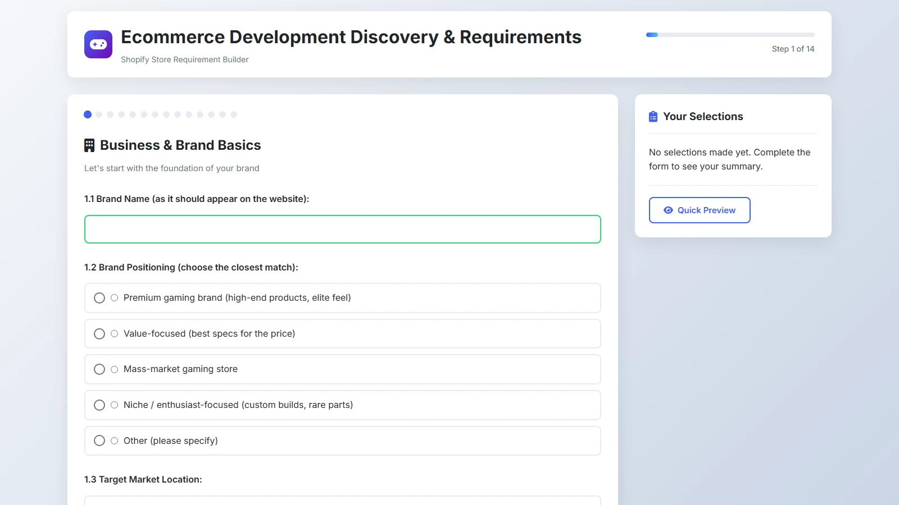

# Shopify Requirement Builder

A local discovery tool for collecting Shopify store requirements before development starts. It guides a client through the store structure, catalog, design, checkout, delivery, marketing and post-launch decisions, then turns the answers into a reviewable summary and PDF.



## What it does

- Guides discovery through 14 sections covering the brand, audience, catalog, design, payments, shipping, legal pages, marketing and support.
- Saves in-progress answers in the browser and keeps a live summary beside the form.
- Opens a quick preview of the completed requirements.
- Exports the collected answers as a PDF with jsPDF.
- Provides Express endpoints that save and retrieve response payloads as JSON files.

## Stack

- Node.js and Express
- HTML and CSS
- Vanilla JavaScript
- jsPDF

## Run it locally

```bash
npm install
npm start
```

Open `http://localhost:3000`. Saved API responses are written to the generated `data/` directory. The API has no authentication, so this app should only be run locally.

## Credits

Created by Ghaleb Mohiuddin Syed. The repository contains no client responses or client branding.

## Licence

The code is available under the [MIT Licence](LICENSE).
